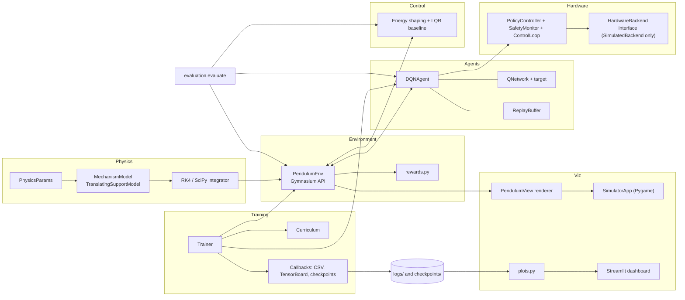
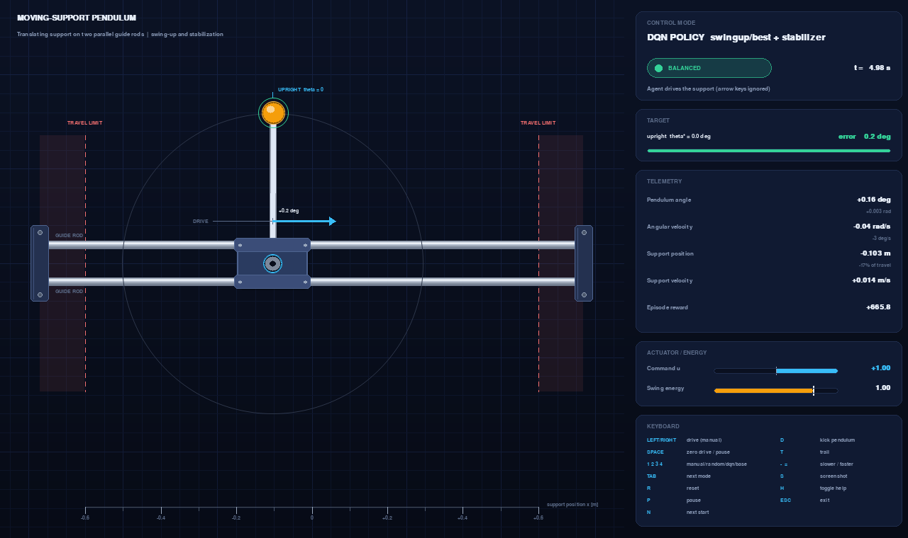
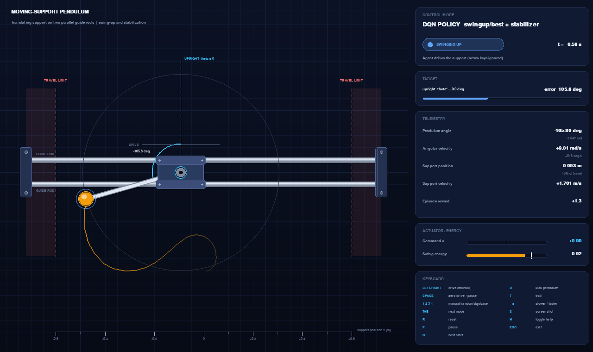
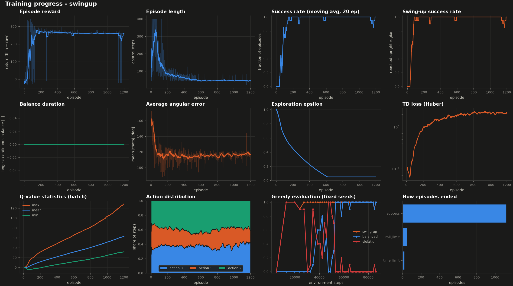
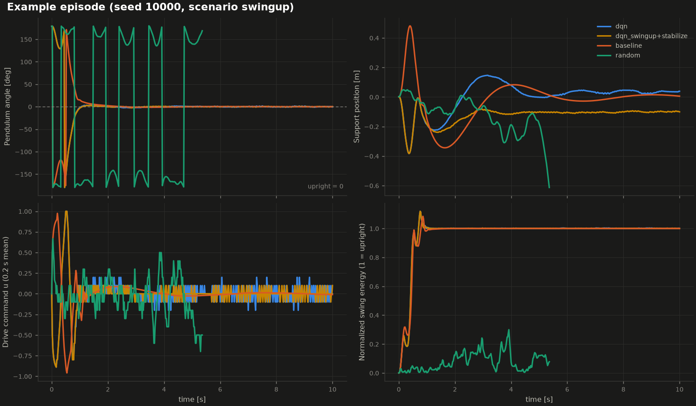

# Reinforcement-learning swing-up and stabilization of a moving-support pendulum

A complete, local, reproducible Python project for a pendulum mounted on a **carriage that slides left and
right on two parallel guide rods**. The goal is to start with the pendulum hanging down, inject energy by
moving the carriage, swing the pendulum up, catch it in the upright position and keep it balanced - first
in simulation (physics, Gymnasium environment, from-scratch PyTorch DQN, model-based baseline, polished
Pygame simulator, evaluation and dashboards), with a documented, deliberately inert interface for a later
hardware port.

> **Honesty note.** Results are only claimed where an evaluation produced them. See
> [Results](#results-measured-in-this-repository) for the numbers measured in this repository and for what
> did *not* work. Nothing in the dashboards or reports is simulated or pre-filled.

## Contents

1. [Mechanical model and assumptions](#1-mechanical-model-and-assumptions)
2. [Architecture](#2-architecture)
3. [State, observation and action definitions](#3-state-observation-and-action-definitions)
4. [Dynamics](#4-dynamics)
5. [Reward function](#5-reward-function)
6. [DQN](#6-dqn)
7. [Training strategy and baseline controller](#7-training-strategy-and-baseline-controller)
8. [Installation](#8-installation)
9. [Launch the simulator](#9-launch-the-simulator)
10. [Training commands](#10-training-commands)
11. [Evaluating a checkpoint](#11-evaluating-a-checkpoint)
12. [Viewing training metrics](#12-viewing-training-metrics)
13. [Tests](#13-tests)
- [Results (measured in this repository)](#results-measured-in-this-repository)
14. [Troubleshooting](#14-troubleshooting)
15. [Limitations and next steps for hardware](#15-limitations-and-next-steps-for-physical-implementation)

---

## 1. Mechanical model and assumptions

The request describes "two parallel supporting rods ... a moving support mounted between them ... the support
mechanism moves left and right". That is ambiguous between three different mechanisms, which have different
equations of motion and must not be mixed:

| Mechanism | Degrees of freedom | Used here? |
|---|---|---|
| **A. Support translates horizontally** on rails, pendulum hinged on it | support position `x`, pendulum angle `theta` | **Yes** |
| B. Support rotates/tilts about its own pivot (rotary arm, tilting beam) | support angle `phi`, pendulum angle | No (different dynamics; see "replacing the model") |
| C. Pendulum rotates relative to a moving support | that is `theta` in A | part of A |

**Chosen model (A).** Two parallel horizontal guide rods are fixed between end posts. A carriage whose linear
bearings ride on both rods slides along them; a belt and DC motor drive *only the carriage*. The pendulum is a
rigid rod hinged to the carriage face about a horizontal axis perpendicular to the rails, so it swings in the
vertical plane containing the rails. The hinge is passive. Why A: "moves left and right ... changing the
pendulum's motion" and two rods that the support is "mounted between" describes a translating carriage on a
rail pair, and it is the standard way to build a physical swing-up pendulum.

This reduces to the same *form* of equations as the classical cart-pole, but the project deliberately models
what makes a physical rig differ from the textbook idealisation:

* a **DC-motor force model** (peak force, back-EMF speed dependence, first-order driver lag) instead of an ideal force input;
* viscous **and Coulomb** friction on the rails *and* in the pendulum hinge;
* a rod with **centre-of-mass offset and its own inertia** (not a point mass on a massless rod);
* **mechanical limits** (finite rail travel with end stops, speed limits) as first-class termination conditions;
* a replaceable model interface, a mechanism-specific renderer and unit-tested energy balance.

**Replacing the model.** The environment, agents, controllers, renderer and hardware layer only talk to the
`MechanismModel` interface in [`physics/dynamics.py`](src/pendulum_rl/physics/dynamics.py) (state layout
`[support coordinate, support rate, pendulum angle, pendulum rate, actuator state]`, `derivatives`, `energy`,
`check_limits`, `finalize`, `linearize_upright`, `force_from_command`). To model a tilting support, subclass it,
register it in `MODEL_REGISTRY` and select it with `physics.mechanism`. The renderer refuses to draw a geometry
it has no routine for (a tilting support is never drawn as a sliding cart); `tests/test_dynamics.py` shows a
drop-in replacement being registered.

**Conventions.** SI units. `theta = 0` upright, `theta = +-pi` hanging down, `theta > 0` tip displaced toward
`+x`. Positive command pushes the carriage toward `+x`. Angles are wrapped to `[-pi, pi)`.

**Assumed default hardware** (all in `configs/default.yaml`; *assumptions, not measurements*): carriage
0.50 kg (including reflected motor inertia), rod 0.15 kg x 0.40 m (uniform, COM at mid-length), peak drive force
10 N, no-load speed 4 m/s, driver lag 20 ms, usable travel +-0.60 m. These were chosen so that swing-up is
*physically feasible* - a 6 N actuator on a +-0.35 m rail cannot swing this pendulum up with the baseline
controller; actuator authority and travel are real design requirements (see [Limitations](#15-limitations-and-next-steps-for-physical-implementation)).

## 2. Architecture



```
src/pendulum_rl/
  config.py                YAML loading, merging, --set overrides, strict validation
  physics/                 parameters.py, dynamics.py (model interface + equations), integrator.py
  environment/             pendulum_env.py (Gymnasium env), rewards.py
  control/baseline.py      energy-shaping swing-up + discrete LQR stabilizer
  agents/                  dqn.py, networks.py, replay_buffer.py
  training/                trainer.py, curriculum.py, callbacks.py
  evaluation/              evaluate.py (policies, metrics), report.py
  visualization/           renderer.py, pygame_simulator.py, plots.py, settings.py,
                           dashboard.py (Streamlit), arena.py + arena_template.html (learning arena: snapshots -> HTML/canvas)
  hardware/interface.py    sensor / estimator / safety / E-stop interface (no real driver)
  utils/                   seeding.py, checkpoints.py
scripts/                   train.py simulate.py evaluate.py random_agent.py plot_training.py
configs/                   default.yaml training.yaml simulation.yaml
tests/                     dynamics, environment, agent, training smoke, hardware, visualization, evaluation
docs/HARDWARE.md          hardware integration contract and pre-deployment checklist
```

## 3. State, observation and action definitions

**Physical state** (5 numbers, `env.state`): `[x, x_dot, theta, theta_dot, a]` - support position [m] and velocity
[m/s], pendulum angle [rad] and angular velocity [rad/s], and the actuator state `a` (the lagged normalized drive,
internal to the motor model). `env.physical_state` gives the 4-vector without `a`.

**Observation** (float32, normalized, 6 numbers; 5 without `include_prev_action`):

| index | value | scale |
|---|---|---|
| 0 | `x / x_limit` | rail half-length 0.6 m |
| 1 | `x_dot / v_max` | 3 m/s |
| 2, 3 | `sin(theta)`, `cos(theta)` | no angle discontinuity at the bottom |
| 4 | `theta_dot / omega_scale` | 15 rad/s |
| 5 | previous command `u_prev` | [-1, 1]; makes the 20 ms actuator lag observable |

Values are clipped to the bounds of `observation_space`. Optional additive sensor noise (`env.noise_*`).

**Actions.** `Discrete(3)` by default: `action_levels: [-1, 0, 1]` = push the carriage toward `-x`, release,
push toward `+x` (fraction of the full drive command, which the motor model turns into force up to 10 N).
Any small number of levels works (e.g. `[-1, -0.3, 0, 0.3, 1]`). `action_mode: continuous` gives `Box(-1, 1, (1,))`
(used by the baseline controller and the keyboard).

**Termination.** `terminated=True` on **success** (balance held for `hold_seconds`, or catch region reached in
`success_mode: reach`; only if `terminate_on_success`) or on a **constraint violation** (`rail_limit`,
`support_overspeed`, `pendulum_overspeed`, `non_finite_state`, `numerical_instability`). `truncated=True` when
`max_episode_seconds` elapse (`time_limit`). Time-limit truncation is *not* terminal in the Bellman target.
`info["episode_metrics"]` summarizes each finished episode (used by training and evaluation).

## 4. Dynamics

Generalized coordinates `(x, theta)`. Support mass `M`, pendulum mass `m`, COM distance `l` from the pivot,
inertia `I` about the COM, `J = I + m l^2` (about the pivot). Kinetic and potential energy:

```
T = 1/2 (M + m) x_dot^2 + m l x_dot theta_dot cos(theta) + 1/2 J theta_dot^2
V = m g l cos(theta)                       (zero at the pivot height; maximal upright)
```

With generalized forces `Q_x = F_motor - F_fric` and `Q_theta = -T_fric`, the Euler-Lagrange equations are

```
(M + m) x_ddot + m l cos(theta) theta_ddot = F_motor - F_fric + m l theta_dot^2 sin(theta)
 m l cos(theta) x_ddot + J theta_ddot      = m g l sin(theta) - T_fric
```

The 2x2 mass matrix has determinant `(M+m) J - (m l cos theta)^2 > 0` for all angles, so the system is solved in
closed form. Hanging (`theta = pi`) is a stable equilibrium, upright (`theta = 0`) is unstable.

* Friction: `F_fric = b_x x_dot + c_x tanh(x_dot / eps_x)`, `T_fric = b_th theta_dot + c_th tanh(theta_dot / eps_th)`.
* Actuator: command `u` in [-1, 1]; driver lag `tau_a a_dot = u - a`; motor force
  `F_motor = clip(F_max (a - x_dot / v_free), -F_max, F_max)` (back-EMF; `motor_free_speed: null` gives an ideal source).
* Integration: fixed-step **RK4** at `dt = 0.005 s` with the command held constant over each 20 ms control period
  (zero-order hold); an adaptive **DOP853** reference (`integrator: scipy`) is used in tests. Angles wrapped after each control step.
* Safeguards: the state is checked for NaN/inf (`NumericalInstabilityError`), the support speed, pendulum speed and rail
  position are limits that terminate the episode, and invalid parameters are rejected.
* Energy: `energy()` reports kinetic/potential/total energy and the *swing energy*
  `E = 1/2 J theta_dot^2 + m g l (cos theta - 1)` normalized to 0 (hanging at rest) .. 1 (upright at rest), which shows how
  the agent injects energy.

Unit tests verify: energy conservation without friction/force (drift < 1e-5 J over 20 s), `dE/dt` equal to mechanical
power input minus dissipation, equilibria, hanging stability/upright instability, the small-oscillation period against
`2 pi / sqrt(m g l / J)`, RK4 vs. DOP853, actuator lag, wrapping and the limit checks.

## 5. Reward function

Per control step, with `theta` wrapped to `[-pi, pi]`, `u` the normalized command and `h = (1 + cos theta)/2`:

```
r =  w_up   * h                                        height: dense signal for swing-up
   + w_prec * exp(-(theta / sigma)^2)                  precision: only a small angular error earns it
   - w_spin * h^2 * (theta_dot / omega_ref)^2          speed penalty, active only near the top
   - w_pos  * (x / x_limit)^4                          stay away from the rail ends
   - w_sp   * (x_dot / v_max)^2                        no gratuitous support motion
   - w_u    * u^2                                      actuator effort
   - w_du   * ((u - u_prev)/2)^2                       aggressive switching
   + success_bonus   (once, when the success criterion is first met)
   - violation_penalty (on a constraint violation, terminal)
```

Defaults: `w_up = 1, w_prec = 1, sigma = 0.25 rad, w_spin = 0.4, omega_ref = 6 rad/s, w_pos = 0.5, w_sp = 0.02,
w_u = 0.02, w_du = 0.02, success_bonus = 50, violation_penalty = 20`. Why each term:

* **height** gives a gradient from the very first swing, so energy pumping is rewarded before the top is reached;
* **precision** concentrates reward on an actually small angular error (reducing angular error);
* **spin penalty** is multiplied by `h^2`, so passing or lingering near the top *while moving fast* is worth less than
  arriving slowly - being near the upright angle is not rewarded by itself;
* **position / support-speed** terms penalize excessive support movement and approaching the mechanical limits;
  nothing rewards motion (`tests/test_environment.py` checks that moving the support is never better than staying still);
* **effort and smoothness** discourage needlessly aggressive actuator action;
* **violation penalty** makes leaving the mechanical limits clearly worse than any behaviour that stays inside.

**Terminal bonuses must outweigh the value of staying alive.** In the swing-up stage success *ends* the episode. An
early run with `success_bonus = 50` first learned to swing up (best greedy snapshot: 100 % reached upright and balanced) but its later snapshots
degraded to 0 % ([`docs/experiments/swingup_success_bonus50_eval.csv`](docs/experiments/swingup_success_bonus50_eval.csv), column
`swing_up_rate`): swinging high without catching earns about 0.8 per step, worth `0.8 / (1 - gamma) = 80` at `gamma = 0.99`, more than the
bonus, so Q-learning correctly learned to *avoid* succeeding. The swing-up stage therefore overrides `success_bonus` to 250
(> `2 / (1 - gamma) = 200`, the largest possible discounted continuation value) via the per-stage `reward:` section of `configs/training.yaml`;
keep it above that bound if you change `gamma`. (A soft-target-update variant of the old run drifted the same way, ruling out the target update as the cause.)

## 6. DQN

Implemented from scratch in [`agents/dqn.py`](src/pendulum_rl/agents/dqn.py) (no RL library).

* Online `QNetwork` (MLP, default `6 -> 128 -> 128 -> 3`, ReLU, configurable `hidden_dims`/`activation`) and a target copy.
* Uniform replay buffer (circular numpy storage, seeded sampling). Stores `terminated` only.
* Epsilon-greedy exploration with a linear schedule over environment steps (restartable per curriculum stage).
* Bellman target `y = r + gamma (1 - terminated) Q_target(s', a*)`, `a* = argmax_a Q_online(s', a)` (Double DQN, `double_dqn: true`)
  or `max_a Q_target(s', a)` (vanilla). Terminal transitions do not bootstrap; time-limit truncations do.
* Huber loss, gradient-norm clipping, Adam; hard target copy every `target_update_interval` gradient steps or soft updates when `tau < 1`.
* Checkpoints (`format_version`, weights, optimizer, config, step counters, metadata with the full physics/env/reward
  configuration and the measured evaluation) loaded with `torch.load(weights_only=True)`; refuses to overwrite existing files.
* CPU or CUDA (`device: auto` picks CUDA when `torch.cuda.is_available()`).
* Per-episode metrics logged to CSV: TD loss, Q mean/min/max, TD error, gradient norm, epsilon, action distribution.

## 7. Training strategy and baseline controller

Three *different* tasks are trained and a single ordinary DQN policy is **not** assumed to solve them all
([`training/curriculum.py`](src/pendulum_rl/training/curriculum.py)):

| mode | stage | start states | success | produces |
|---|---|---|---|---|
| `stabilize` | A | near upright (+-0.25 rad, +-0.5 rad/s) | balance held 2 s | a **stabilization policy** |
| `swingup` | B | hanging (+-0.1 rad) | enter the catch region (`abs(theta) <= 0.35`, `abs(theta_dot) <= 4`) | a **swing-up-only policy** |
| `combined` | C | 50 % upright / 50 % hanging, physics +-10 %, random velocity kicks | balance held 2 s | one **combined policy** |
| `curriculum` | A -> B -> C | as above | per-stage promotion on rolling success rate | one network trained through all stages |

`swingup` and `stabilize` checkpoints can also be chained at evaluation time (`SwitchingPolicy`: the swing-up policy
hands over to the stabilizer inside the catch region).

**Baseline** ([`control/baseline.py`](src/pendulum_rl/control/baseline.py)): swing-up by energy shaping
(Astrom-Furuta), `a = k (E - E_ref) sign(theta_dot cos theta)`, converted to a normalized drive command, with rail-aware pumping, a
washout-filtered PD that removes carriage drift, and a soft virtual end stop; switching to a discrete-time LQR designed on the linearization
about upright (`MechanismModel.linearize_upright`) inside a capture region, with hysteresis. It is a **reference** for comparison;
it uses the true model and continuous commands, which the DQN agent does not.

## 8. Installation

Python >= 3.11. A virtual environment is recommended.

```bash
python -m venv .venv && source .venv/bin/activate           # Windows: .venv\Scripts\activate
pip install -r requirements.txt
pip install -e .                                             # optional: makes `pendulum_rl` importable everywhere
```

or with [uv](https://docs.astral.sh/uv/): `uv venv --python 3.11 .venv && uv pip install -r requirements.txt`.
CPU-only PyTorch (smaller): `pip install torch --index-url https://download.pytorch.org/whl/cpu`.
The scripts in `scripts/` add `src/` to `sys.path`, so they also work without `pip install -e .`.
Streamlit (`pip install streamlit`) and TensorBoard (`pip install tensorboard`) are optional.

## 9. Launch the simulator

```bash
python scripts/simulate.py                                    # manual keyboard control, hanging start
python scripts/simulate.py --mode baseline                    # watch the model-based controller swing up
python scripts/simulate.py --mode dqn --checkpoint checkpoints/combined/best.pt
python scripts/simulate.py --mode dqn --checkpoint checkpoints/swingup/best.pt --stabilizer-checkpoint checkpoints/stabilize/best.pt
python scripts/simulate.py --mode random --start upright
python scripts/simulate.py --headless --mode baseline --seconds 8 --screenshot outputs/baseline.png   # no window (alias: --no-render)
```

The window shows the two guide rods, end posts and travel limits, the carriage with its bearing blocks, the hinge and pendulum
with a fading tip trail, the upright reference line and the angle arc, and a HUD with angle (deg and rad), angular velocity,
support position and velocity, current command, swing energy, episode reward, time, control mode, target/error and the phase
(**swinging up / stabilizing / balanced / failed**). Physics runs in fixed 20 ms steps from an accumulator, independent of the render
frame rate, with interpolation between states for smooth motion.

| key | action |
|---|---|
| Left / Right | negative / positive drive (manual mode only) |
| Space | manual: zero drive while held; agent modes: pause |
| 1 / 2 / 3 / 4, Tab | manual / random / DQN / baseline; cycle modes |
| R, P | reset, pause |
| N | cycle the next reset's start (hanging / upright / random) |
| D | kick the pendulum (disturbance) |
| T, H, - / = | trail, help panel, slower / faster |
| S | screenshot to `outputs/screenshots/` |
| Esc | exit |



In every mode except manual the arrow keys are **ignored with an on-screen notice** - keyboard and agent commands never mix silently.
Mode 3 without a loaded checkpoint is refused with a message.

On WSL without WSLg there is no display: use `--headless`, or run the simulator with a Windows-side Python.

## 10. Training commands

All commands log to `logs/<run>/` (`episodes.csv`, `eval.csv`, `summary.json`, `run_config.yaml`) and save
`checkpoints/<run>/best.pt` (best greedy evaluation), `final.pt` and `best_<stage>.pt`. A run directory is never overwritten
unless you pass `--overwrite`. Options: `--episodes N`, `--seed S`, `--device auto|cpu|cuda`, `--dt 0.005`, `--run-name NAME`, `--init-from CKPT`,
`--tensorboard`, `--render`, `--eval-every`, `--eval-episodes`, `--print-every`, `--snapshot-every N` (network snapshots in
`checkpoints/<run>/snapshots/` for the dashboard's learning arena, default 25, 0 = off), `--config FILE`, `--set section.key=value`.

```bash
# Stage A - stabilization policy (start near upright)
python scripts/train.py --mode stabilize --episodes 400

# Stage B - swing-up policy (start hanging, success = reach the catch region)
python scripts/train.py --mode swingup --episodes 1200

# Stage C - combined policy (both start types, randomized physics, disturbances)
python scripts/train.py --mode combined --episodes 1000

# Curriculum A -> B -> C with promotion on rolling success rate (--episodes caps each stage)
python scripts/train.py --mode curriculum

# Examples
python scripts/train.py --mode stabilize --episodes 50 --run-name quick --seed 1 --device cpu
python scripts/train.py --mode swingup --set dqn.gamma=0.995 --set env.action_levels=[-1,-0.3,0,0.3,1]
python scripts/train.py --mode combined --init-from checkpoints/stabilize/best.pt --run-name combined_warm
```

Random-policy sanity check of the Gymnasium environment: `python scripts/random_agent.py --episodes 5`.

## 11. Evaluating a checkpoint

```bash
python scripts/evaluate.py --checkpoint checkpoints/stabilize/best.pt --scenario stabilize --episodes 50
python scripts/evaluate.py --checkpoint checkpoints/swingup/best.pt --scenario swingup --episodes 50
python scripts/evaluate.py --checkpoint checkpoints/swingup/best.pt --stabilizer-checkpoint checkpoints/stabilize/best.pt --scenario swingup
python scripts/evaluate.py --checkpoint checkpoints/combined/best.pt --scenario combined --randomize 0.1 --disturbance-prob 0.005
python scripts/evaluate.py --scenario swingup --untrained-dqn        # baseline + random + a freshly initialised network
```

Every controller runs the same fixed seeds (hence identical initial states). Output in `outputs/eval_<scenario>/`:
`episodes_<controller>.csv`, `summary.csv`, `comparison.png`, `trajectories.png` and `report.md`. Measured per controller:
swing-up success rate, balanced-for-2-s rate, mean and maximum angular error, time to reach the upright region, balanced time,
total actuator effort (integral of |u|, and of u^2), mechanical-constraint violations (by reason) and return. The **status label**
is `untrained` (no learning steps), `partially trained` (training happened, primary success < 80 %) or `trained` (>= 80 %), computed from the
measured primary metric of the evaluated scenario (`balance_rate` for stabilize/combined, `swing_up_rate` for swingup).

## 12. Viewing training metrics and the learning arena

```bash
python scripts/plot_training.py --run logs/combined             # 12-panel figure -> logs/combined/training.png
tensorboard --logdir logs                                       # if trained with --tensorboard
pip install streamlit && streamlit run src/pendulum_rl/visualization/dashboard.py     # then open http://localhost:8501
```

**Learning arena** (first tab of the dashboard) shows *what the network had learned after N training episodes*. It replays
the same start condition (default: pendulum hanging at the bottom) with the network saved at each snapshot
(`checkpoints/<run>/snapshots/ep_<N>.pt`, written every `--snapshot-every` episodes, default 25;
`ep_00000.pt` is the untrained network) in an animated copy of the simulator scene: carriage on the two rods, pendulum, trail,
phase badge (swinging up / stabilizing / balanced / failed), telemetry, command and swing-energy bars, an angle-vs-time strip
that overlays the previous snapshot, and the greedy-evaluation curve logged during training. Drag the **training episode** slider
(or press the arrow keys) to jump between snapshots, or press *Play the training story* to watch the policy improve in order.
You can change the start (bottom / near the top / random), the start seed and the episode length, and kick the pendulum
mid-run to test recovery. Every frame is simulated by the real environment driven by the saved greedy policy; nothing is faked.

The **Train** tab starts `scripts/train.py` from the page (never overwriting an existing run) and shows its progress; the new
snapshots can then be opened in the arena. The same thing from a terminal, e.g. the run used for the measured example below:

```bash
python scripts/train.py --mode combined --episodes 500 --snapshot-every 10 --eval-every 10 --run-name showcase
```

Runs trained before snapshots existed can only show their `best.pt` / `final.pt` (the arena says so). The other tabs show episode
reward (+ moving average), episode length, success rate, swing-up success rate, balance duration, average angular error, epsilon,
TD loss, Q-value statistics, action distribution, greedy-evaluation rates and termination reasons. With no logs/checkpoints the
dashboard says so. Raw data: `logs/<run>/*.csv`.

In the `showcase` run (seed 0, 500 episodes, combined mode), replayed from the bottom with start seed 1 (measured, 51 snapshots):
the untrained network (episode 0) drives the carriage into the rail end after 0.4 s; snapshots 10-40 either leave the
pendulum hanging (20, 30) or hit the rail (10, 40); the first snapshot that swings up (in about 0.9 s) and balances for the whole 10 s is episode 50. Learning is not
monotonic: of the 46 snapshots from episode 50 to 500, 40 succeed from this start and 6 do not (episodes 70, 110, 360, 430,
470 and 490 lose the top or hit the rail). This is one training seed and one start condition; the greedy-evaluation curve in
the arena (10 fixed starts per point) is the more reliable picture.

## 13. Tests

```bash
pip install pytest
pytest                  # full suite
pytest -m "not slow"    # skip the short training runs
```

Status when this README was written: **138 tests passed** (the dashboard tests are skipped when Streamlit is not installed).

Covers state/observation dimensions, observation-space validity, action validation, reset/step semantics, termination and
truncation, reproducibility, finite physics values and invariants, replay sampling, Q-network shapes, Bellman targets (terminal and
double-DQN), DQN updates/target sync/clipping, checkpoint save/load/overwrite protection, a short end-to-end training run with
logs, curriculum logic, config errors, the hardware safety logic, the renderer/simulator (headless), the evaluation/report pipeline and
the learning arena (training snapshots, replayed trajectories, the generated HTML page and the dashboard tabs).

## Results (measured in this repository)



Everything below was produced by the commands in sections 10-12 on one CPU machine (Python 3.11.17, PyTorch 2.14 CPU, **one training run per
mode with `--seed 0`**) and is reproducible from the saved logs/configs. Evaluation uses 100 episodes with seeds 10000-10099, which are *not* the
seeds used during training (derived from the run seed) nor those used for choosing `best.pt` (50000-50009), so the numbers are not selection-biased
by the seed choice. Reports with all metrics: `outputs/eval_*/report.md`, `summary.csv`, `episodes_<controller>.csv`, `*.png` (copies of the reports behind the tables below are kept in [`docs/reports/`](docs/reports/); `outputs/`, `logs/` and `checkpoints/` are git-ignored).

**Success definitions.** *swing-up*: the pendulum entered the upright region (<= 20 deg from upright) at least once; *balanced*: held <= 5.7 deg
and <= 1 rad/s continuously for >= 2 s and finished without a constraint violation; *violation*: rail end or a speed limit reached. "Effort" is the
time integral of |command| over the 8-10 s episode, so 1.0 means one second of full drive. *Mean angle error* averages over the whole episode,
including the swing-up transient.

### Training runs

| run (command, defaults of `configs/training.yaml`) | episodes / env steps | wall time | status label from the final 30-episode greedy evaluation | first greedy eval at 100 % (10 episodes) |
|---|---|---|---|---|
| `train.py --mode stabilize` | 400 / 136,590 | 12 min | **trained** (balanced 100 %) | 24k steps |
| `train.py --mode swingup` | 1200 / 86,069 | 9 min | **trained** (swing-up 100 %) | 13k steps |
| `train.py --mode combined` | 1000 / 443,414 | 34 min | **trained** (balanced 100 %) | 46k steps |
| `train.py --mode curriculum` (A -> B -> C, one network) | 1639 / 605,460 (A: 395 episodes, promoted at 90 % rolling success; B: 244 episodes, promoted at 80 %; C: 1000 episodes = its full budget, since a rolling success of 100 % was never reached under exploration) | 39 min | **trained** (balanced 100 %) | - |

(Wall times were measured with up to four runs sharing four CPU cores; the swing-up run is short because each episode ends at the catch.) The label
rule is in section 11. Greedy-evaluation stability during training: stabilize 100 % of evaluations at 100 % balanced in the second half of training;
swing-up 97 % of evaluations at 100 % (minimum 90 %); combined 84 % of evaluations at 100 % with a **minimum of 40 %** (curriculum run, combined stage: 90 % at 100 %, also a minimum of 40 %) - learning is not monotonic, which is
why `best.pt` and an independent evaluation exist. The curriculum run's swing-up stage was fast (244 episodes, 15k steps) because it started from the Stage A network.

### Independent evaluation (nominal physics, 100 episodes each)

| scenario | controller | label | swing-up | balanced | violations | mean angle error | time to upright | effort |
|---|---|---|---|---|---|---|---|---|
| stabilize | **DQN** `stabilize/best.pt` (24k steps) | trained | 100 % | 100 % | 0 % | 0.7 deg | - | 2.65 |
| stabilize | baseline (LQR) | reference | 100 % | 100 % | 0 % | 0.5 deg | - | 0.17 |
| stabilize | random | reference | - | 0 % | 86 % | 96.4 deg | - | 2.45 |
| swingup | **DQN** `swingup/best.pt` alone (70k steps) | trained | 100 % | 100 % | 0 % | 10.9 deg | **0.84 s** | 5.91 |
| swingup | **DQN** swing-up -> stabilizer hand-off | trained | 100 % | 100 % | 0 % | 10.6 deg | **0.84 s** | 3.90 |
| swingup | baseline (energy shaping + LQR) | reference | 100 % | 100 % | 0 % | 11.5 deg | 0.91 s | 0.87 |
| swingup | random | reference | 1 % | 0 % | 96 % | 155.4 deg | 9.5 s | 2.43 |
| swingup | untrained network (random init) | **untrained** | 0 % | 0 % | 0 % | 179.7 deg | - | 0.00 |
| swingup | **DQN** `swingup/final.pt` (86k steps) | trained | 100 % | 100 % | 0 % | 10.9 deg | 0.86 s | 7.84 |
| combined | **DQN** `combined/best.pt` (418k steps) | trained | 100 % | 100 % | 0 % | 5.4 deg | 0.41 s | 2.84 |
| combined | **DQN** `combined/final.pt` (443k steps) | trained | 100 % | 100 % | 0 % | 5.4 deg | 0.42 s | 3.83 |
| combined | **DQN** `swingup/best.pt` -> `stabilize/best.pt` hand-off (two specialists, no combined training) | trained | 100 % | 100 % | 0 % | 5.5 deg | 0.43 s | 3.52 |
| combined | **DQN** `curriculum/best.pt` (456k steps, stages A -> B -> C) | trained | 100 % | 100 % | 0 % | 5.6 deg | 0.42 s | 2.09 |
| swingup | **DQN** `curriculum/best.pt` | trained | 100 % | 100 % | 0 % | 10.8 deg | 0.84 s | 2.32 |
| combined | baseline | reference | 100 % | 100 % | 0 % | 5.8 deg | 0.46 s | 0.51 |
| combined | random | reference | 52 % | 0 % | 95 % | 124.5 deg | 0.09 s | 2.43 |

(The "time to upright" of the combined scenario averages over 50 % upright starts, hence the smaller numbers. The `swingup/best.pt` policy on its own
also balances, because the evaluation continues after the catch - it was only *trained* to reach the catch region.)

### Stress test (+-10 % physics randomization, random +-3 rad/s velocity kicks at 0.005 per step, i.e. about one every 4 s)

| scenario | controller | label | swing-up | balanced | violations | mean angle error |
|---|---|---|---|---|---|---|
| stabilize | DQN `stabilize/best.pt` | **partially trained** (65 % < 80 %) | 100 % | 65 % | 35 % | 1.5 deg |
| stabilize | baseline | reference | 100 % | 76 % | 24 % | 1.5 deg |
| combined | DQN `combined/best.pt` | trained | 100 % | 94 % | 6 % | 6.5 deg |
| combined | DQN `curriculum/best.pt` | trained | 100 % | 89 % | 11 % | 7.6 deg |
| combined | baseline | reference | 100 % | 70 % | 30 % | 7.9 deg |

### What these numbers do and do not show

* **The task is solved in simulation by DQN, as measured here.** The learned policies swing the pendulum up from hanging in about 0.85 s (the baseline: 0.91 s)
  and balance it, with no constraint violations in 100 nominal episodes per scenario. The learned stabilizer matches the LQR baseline; the combined policy
  (trained directly or through the curriculum) needs no hand-designed switching. A swing-up policy chained with a separately trained stabilizer works as well as the single swing-up policy.
* **This is not evidence that DQN beats the baseline.** The differences in speed (0.05-0.07 s) and accuracy (<= 0.6 deg) are small, from single training
  runs and a narrow initial-state distribution (+-0.1 rad around hanging). In the stress test the baseline is *favoured* in model knowledge - it rebuilds
  its LQR from each episode's true, perturbed parameters, whereas the DQN never sees them - but its swing-up/capture gains were hand-tuned on the nominal
  system and it has no dedicated recovery from large kicks. The combined DQN was trained with kicks (probability 0.002, +-2 rad/s) and +-10 % physics, and
  the test is stronger (0.005, +-3 rad/s), so 94 % vs 70 % is a real but narrow finding. The stabilization-only DQN, trained without randomization or kicks,
  is *worse* than the baseline under the same test (65 % vs 76 %).
* **Actuator effort is much larger for DQN** (2.7-7.8 vs 0.17-0.87 for the baseline). The three-level policy chatters between +-full drive; the average command is small but the
  mechanical stress is not. See [Limitations](#15-limitations-and-next-steps-for-physical-implementation).
* **Training stability is mixed.** The first swing-up run (`success_bonus = 50`) learned the task and then *unlearned* it (greedy swing-up rate fell from 100 % to 0 %,
  [`docs/experiments/swingup_success_bonus50_eval.csv`](docs/experiments/swingup_success_bonus50_eval.csv)) because of a reward-design flaw explained in section 5; after fixing it the
  swing-up run was at 100 % balanced in 27 of its last 30 greedy evaluations (lowest 80 %). The combined run shows dips to 40 % between snapshots. Only one seed per configuration was trained.
* **Not claimed:** anything about real hardware, robustness beyond the stress test above, other seeds/hyper-parameters, or more demanding start states (e.g. random angles).






## 14. Troubleshooting

| Symptom | Cause / fix |
|---|---|
| `pygame.error: No available video device` / no window on WSL | WSL without WSLg has no display. Use `--headless` (offscreen frames, `--screenshot`), or run the simulator with Windows Python (`pip install pygame numpy scipy gymnasium pyyaml torch` there and run `python scripts/simulate.py`). |
| `UserWarning: 'fc-list' is missing, system fonts cannot be loaded` | Harmless: pygame falls back to its bundled font. `apt install fontconfig fonts-dejavu` for nicer text. |
| `ImportError ... torch._dynamo` / `AttributeError: module 'sys' has no attribute 'get_int_max_str_digits'` | A *pre-release* CPython (e.g. Ubuntu 22.04's `3.11.0rc1`) cannot import current PyTorch. Use a final 3.11+/3.12 (`uv python install 3.11`, pyenv, python.org). |
| `error: Run '<name>' already has results ...` | Trained runs are never replaced implicitly. Choose another `--run-name` or pass `--overwrite`. |
| `Checkpoint '...' does not exist` | The message lists the checkpoints that do exist. Train one first (section 10); `best.pt` appears after the first greedy evaluation. |
| `Unknown config key(s) ... (did you mean ...)` | Typos in YAML or `--set` are rejected rather than ignored. |
| `control_dt must be an integer multiple of physics.dt` | `--dt` must divide `env.control_dt` (0.02 s): 0.005, 0.004, 0.01, 0.0025 ... |
| Training seems stuck at 0 % success | Success is judged on *training* episodes that still contain epsilon-random actions; watch the greedy evaluation lines (`eval @ ...`) and `logs/<run>/eval.csv` instead. |
| Greedy performance drops late in a run | DQN is not monotonic: later snapshots can be worse than earlier ones. `best.pt` is the best greedy evaluation (selected on 10 fixed seeds); always confirm with `scripts/evaluate.py` on *different* seeds. |
| `ENOMEM` / `Cannot allocate memory` while pip/uv installs | Transient memory pressure on WSL; rerun the install. |
| `findfont` / font warnings in plots | Only cosmetic; plots use the bundled DejaVu Sans. |
| Dashboard says "No training runs found" | There is nothing in `logs/` yet; it never shows placeholder data. Start `scripts/train.py` and refresh. |
| Slow training | Tiny MLPs are fastest on CPU with `training.torch_threads: 1`; run several seeds/variants in parallel processes instead of using more threads. `dqn.train_freq` / `dqn.gradient_steps` trade speed for sample efficiency. |

## 15. Limitations and next steps for physical implementation

**What this is not.** A hardware-validated controller. Everything is simulated with *assumed* parameters
(section 1). A policy that is "trained" here has only been shown to work in this simulator.

Known limitations of the model and of the learned policies:

* **Actuator authority and travel are design requirements.** The swing-up needs roughly 10 N of drive force and about
  +-0.5 m of travel in this configuration; with 6 N / +-0.35 m even the model-based baseline fails. Check force, speed and travel before building.
* **Chattering.** A 3-level DQN switches between full-left and full-right every few control steps; the measured actuator effort is far above the
  baseline's (see Results). The 20 ms motor lag smooths it in simulation; a real driver, belt and gearbox may not tolerate it. Options: more action levels,
  a larger smoothness/effort penalty, action repeat, a continuous-action algorithm (SAC/TD3), or an output filter - all of which must be re-validated.
* **No sensor noise, quantization or delay in the default training**, only actuator lag. Noise options exist (`env.noise_*`), but robustness to realistic
  sensing and latency has not been evaluated.
* **Limited parameter randomization (+-10 %) and nominal disturbances.** Mass, friction, force and length vary, but backlash, belt stretch, a non-level rail,
  stiction and unmodelled dynamics do not exist in the simulator.
* **DQN training is unstable** (non-monotonic learning curves, see Results); results depend on checkpoint selection and the evaluation seeds. Single-seed
  training runs are reported - they are *not* statistically representative. Repeat with several seeds (`--seed`) before drawing conclusions.
* **Discrete actions only** for the learned agents; the baseline uses continuous commands and the true model.
* **Episode success definition** (2 s of balance within 0.1 rad / 1 rad/s) is a simulation metric, not a certification of long-term stability.
* The renderer draws only the translating-support geometry (it refuses others).

Next steps before any hardware run (details in [`docs/HARDWARE.md`](docs/HARDWARE.md)): identify the physical parameters, add sensor noise/latency to
training, retrain and re-evaluate with `--randomize`/`--disturbance-prob` and noise, develop a hardware backend with a hardware E-stop, run the
simulated control loop (`ControlLoop` + `SimulatedBackend`), then begin with the pendulum disconnected and heavily limited commands.
