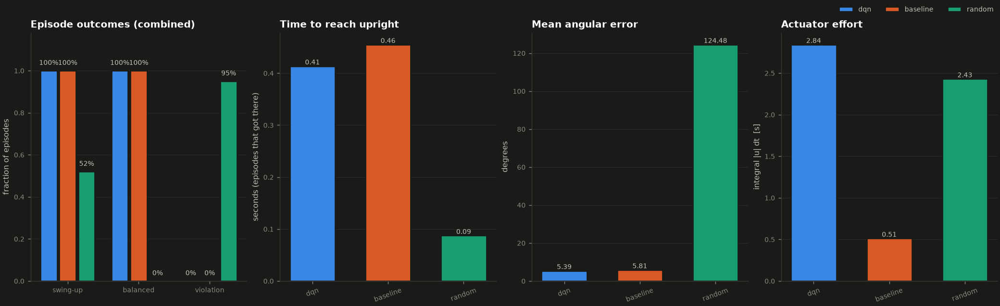
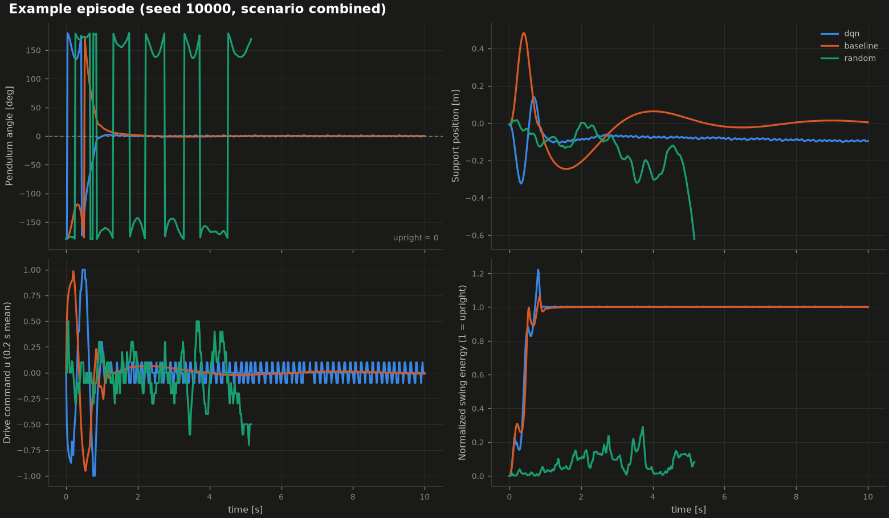

# Evaluation report - scenario `combined`

* Episodes per controller: **100** (seeds 10000 .. 10099, identical for every controller)
* Primary metric for this scenario: **balance_rate** (label thresholds: *trained* needs >= 80%)
* checkpoint: checkpoints/combined/best.pt
* training: combined mode, 418414 environment steps, 950 episodes
* robustness test: none (nominal physics, no disturbances)

Success definitions: *swing-up* = pendulum entered the upright region (angle error <= 0.35 rad); *balanced* = held angle error <= 0.1 rad and angular velocity <= 1 rad/s continuously for >= 2 s without a constraint violation; *violation* = rail end, speed limit or numerical limit reached. *Actuator effort* = time integral of the absolute normalized command [s].

## Results

| Controller | Status label | Swing-up | Balanced | Violations | Mean angle error | Time to upright (mean) | Actuator effort |
|---|---|---|---|---|---|---|---|
| dqn | trained | 100% | 100% | 0% | 5.4 deg | 0.41 s | 2.84 |
| baseline | reference | 100% | 100% | 0% | 5.8 deg | 0.46 s | 0.51 |
| random | reference | 52% | 0% | 95% | 124.5 deg | 0.09 s | 2.43 |

More statistics (maximum error, balance durations, violation reasons) are in `summary.csv`; per-episode data in `episodes_<controller>.csv`.

## Reading the results

* **dqn**: 100% of episodes met the primary criterion (balance_rate) -> labelled **trained**.
* **baseline**: 100% of episodes met the primary criterion (balance_rate) -> labelled **reference**.
* **random**: 0% of episodes met the primary criterion (balance_rate) -> labelled **reference**; violations: {'rail_limit': 95}.
* The learned policy `dqn` is statistically indistinguishable from the model-based baseline on `balance_rate` (100% vs 100%; difference +0 points, 2 standard errors = 0 points).
* Sampling uncertainty: with 100 episodes a success rate has a binomial standard error of up to 5 percentage points; this is one training run and one set of initial conditions, so small differences are not conclusive.

## Figures

_Generated by `scripts/evaluate.py`; every number above was measured in this run._
