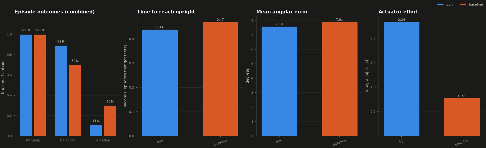
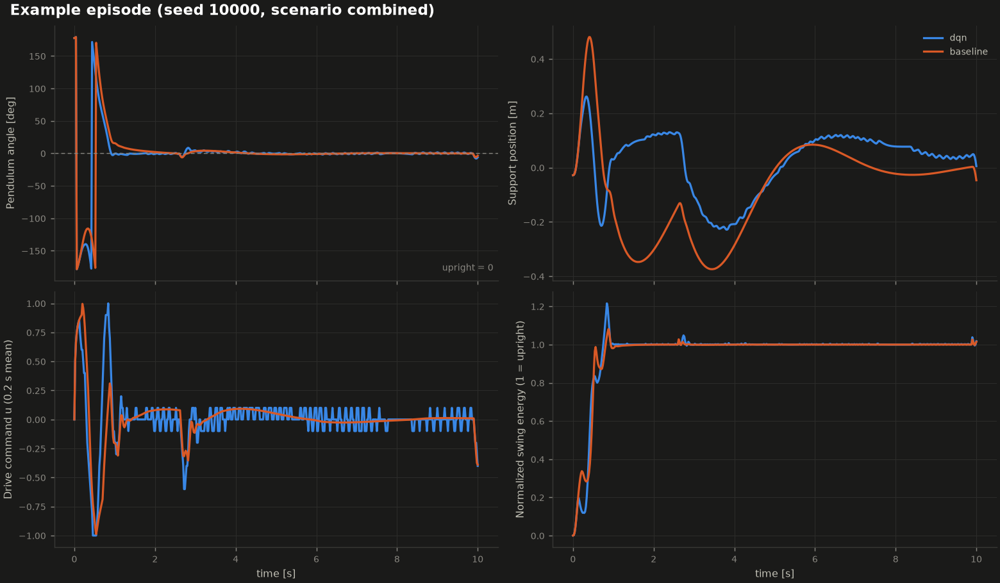

# Evaluation report - scenario `combined`

* Episodes per controller: **100** (seeds 10000 .. 10099, identical for every controller)
* Primary metric for this scenario: **balance_rate** (label thresholds: *trained* needs >= 80%)
* checkpoint: checkpoints/curriculum/best.pt
* training: curriculum mode, 456085 environment steps, 1314 episodes
* robustness test: physics randomization +-10%, disturbance prob 0.005

Success definitions: *swing-up* = pendulum entered the upright region (angle error <= 0.35 rad); *balanced* = held angle error <= 0.1 rad and angular velocity <= 1 rad/s continuously for >= 2 s without a constraint violation; *violation* = rail end, speed limit or numerical limit reached. *Actuator effort* = time integral of the absolute normalized command [s].

## Results

| Controller | Status label | Swing-up | Balanced | Violations | Mean angle error | Time to upright (mean) | Actuator effort |
|---|---|---|---|---|---|---|---|
| dqn | trained | 100% | 89% | 11% | 7.6 deg | 0.44 s | 2.34 |
| baseline | reference | 100% | 70% | 30% | 7.9 deg | 0.47 s | 0.78 |

More statistics (maximum error, balance durations, violation reasons) are in `summary.csv`; per-episode data in `episodes_<controller>.csv`.

## Reading the results

* **dqn**: 89% of episodes met the primary criterion (balance_rate) -> labelled **trained**; violations: {'rail_limit': 11}.
* **baseline**: 70% of episodes met the primary criterion (balance_rate) -> labelled **reference**; violations: {'rail_limit': 30}.
* The learned policy `dqn` is better than the model-based baseline on `balance_rate` (89% vs 70%; difference +19 points, 2 standard errors = 11 points).
* Sampling uncertainty: with 100 episodes a success rate has a binomial standard error of up to 5 percentage points; this is one training run and one set of initial conditions, so small differences are not conclusive.

## Figures

_Generated by `scripts/evaluate.py`; every number above was measured in this run._
