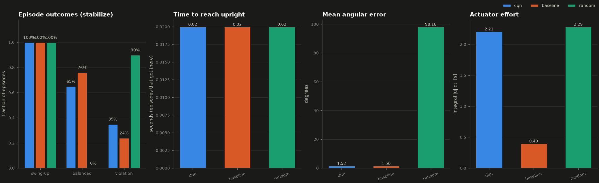
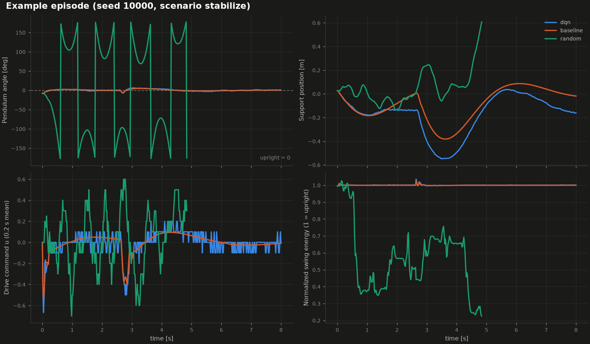

# Evaluation report - scenario `stabilize`

* Episodes per controller: **100** (seeds 10000 .. 10099, identical for every controller)
* Primary metric for this scenario: **balance_rate** (label thresholds: *trained* needs >= 80%)
* checkpoint: checkpoints/stabilize/best.pt
* training: stabilize mode, 24302 environment steps, 100 episodes
* robustness test: physics randomization +-10%, disturbance prob 0.005

Success definitions: *swing-up* = pendulum entered the upright region (angle error <= 0.35 rad); *balanced* = held angle error <= 0.1 rad and angular velocity <= 1 rad/s continuously for >= 2 s without a constraint violation; *violation* = rail end, speed limit or numerical limit reached. *Actuator effort* = time integral of the absolute normalized command [s].

## Results

| Controller | Status label | Swing-up | Balanced | Violations | Mean angle error | Time to upright (mean) | Actuator effort |
|---|---|---|---|---|---|---|---|
| dqn | partially trained | 100% | 65% | 35% | 1.5 deg | 0.02 s | 2.21 |
| baseline | reference | 100% | 76% | 24% | 1.5 deg | 0.02 s | 0.40 |
| random | reference | 100% | 0% | 90% | 98.2 deg | 0.02 s | 2.29 |

More statistics (maximum error, balance durations, violation reasons) are in `summary.csv`; per-episode data in `episodes_<controller>.csv`.

## Reading the results

* **dqn**: 65% of episodes met the primary criterion (balance_rate) -> labelled **partially trained**; violations: {'rail_limit': 35}.
* **baseline**: 76% of episodes met the primary criterion (balance_rate) -> labelled **reference**; violations: {'rail_limit': 24}.
* **random**: 0% of episodes met the primary criterion (balance_rate) -> labelled **reference**; violations: {'rail_limit': 90}.
* The learned policy `dqn` is statistically indistinguishable from the model-based baseline on `balance_rate` (65% vs 76%; difference -11 points, 2 standard errors = 13 points).
* Sampling uncertainty: with 100 episodes a success rate has a binomial standard error of up to 5 percentage points; this is one training run and one set of initial conditions, so small differences are not conclusive.

## Figures

_Generated by `scripts/evaluate.py`; every number above was measured in this run._
