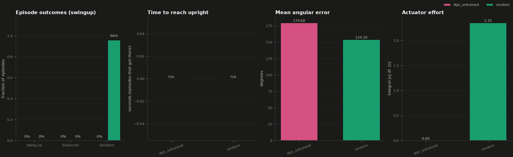
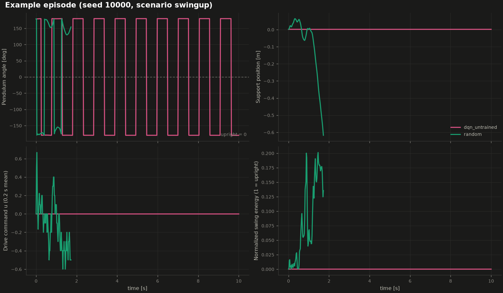

# Evaluation report - scenario `swingup`

* Episodes per controller: **50** (seeds 10000 .. 10049, identical for every controller)
* Primary metric for this scenario: **swing_up_rate** (label thresholds: *trained* needs >= 80%)
* checkpoint: none
* training: n/a
* robustness test: none (nominal physics, no disturbances)

Success definitions: *swing-up* = pendulum entered the upright region (angle error <= 0.35 rad); *balanced* = held angle error <= 0.1 rad and angular velocity <= 1 rad/s continuously for >= 2 s without a constraint violation; *violation* = rail end, speed limit or numerical limit reached. *Actuator effort* = time integral of the absolute normalized command [s].

## Results

| Controller | Status label | Swing-up | Balanced | Violations | Mean angle error | Time to upright (mean) | Actuator effort |
|---|---|---|---|---|---|---|---|
| dqn_untrained | untrained | 0% | 0% | 0% | 179.7 deg | n/a s | 0.00 |
| random | reference | 0% | 0% | 96% | 154.2 deg | n/a s | 2.35 |

More statistics (maximum error, balance durations, violation reasons) are in `summary.csv`; per-episode data in `episodes_<controller>.csv`.

## Reading the results

* **dqn_untrained**: 0% of episodes met the primary criterion (swing_up_rate) -> labelled **untrained**.
* **random**: 0% of episodes met the primary criterion (swing_up_rate) -> labelled **reference**; violations: {'rail_limit': 48}.
* Sampling uncertainty: with 50 episodes a success rate has a binomial standard error of up to 7 percentage points; this is one training run and one set of initial conditions, so small differences are not conclusive.

## Figures

_Generated by `scripts/evaluate.py`; every number above was measured in this run._
