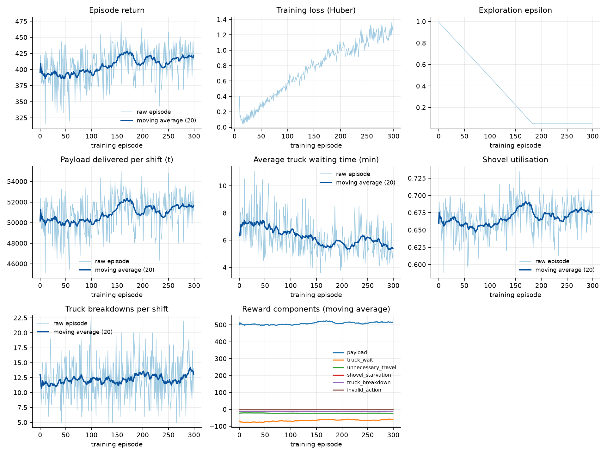
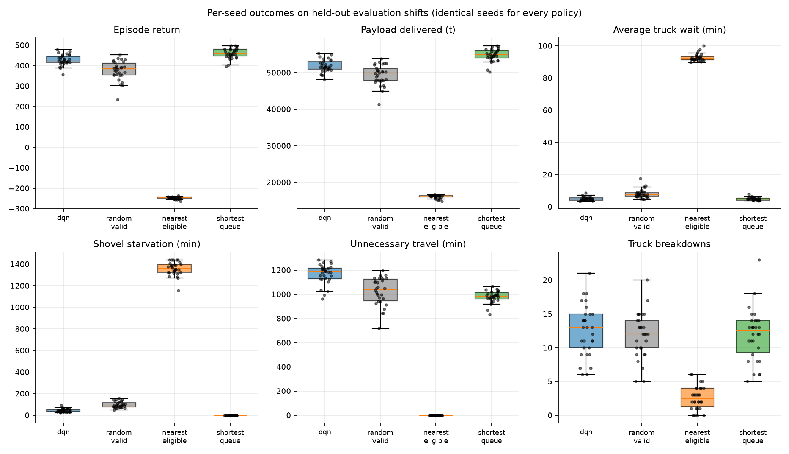

# Intelligent Fleet Dispatching with Deep Q-Learning

A masked **Double DQN**, implemented from scratch in PyTorch, that learns how to dispatch haul trucks to
loading shovels in a simulated open-pit mine. A Gymnasium environment wraps a discrete-event simulator. Three
classical dispatch rules serve as baselines, evaluated on identical held-out shifts.

> **This is a simulation study on synthetic data.** It is not a validated real-world dispatching system. No
> mining database is used, and the numbers below describe the simulator, not any real operation.



---

## Problem

A haul truck spends its shift cycling between a depot and loading shovels. Each time a truck becomes idle, someone
has to decide which shovel it goes to. The choice trades off travel distance (nearer is cheaper) against queueing
(a shovel that already has a line of trucks adds waiting time), and it has to be made while breakdowns and
variable travel times keep shifting the picture. The objective is throughput: tonnes delivered per shift, with
waiting, unnecessary travel, shovel starvation, and breakdown disruption as costs.

## Why reinforcement learning

Dispatch is a **sequential decision problem under uncertainty**. Each choice changes the future queue state, and its
payoff (tonnes delivered) only materialises after a full haul cycle. A supervised model would need labels for "the
right shovel," and no such labels exist. A rule like "nearest shovel" ignores congestion. A policy that is learned
from simulated outcomes can weigh both effects at once, and the simulator provides the feedback signal. The
question this repository asks is whether a DQN learns something a simple rule does not. The answer is reported
honestly below.

---

## System architecture

```
configs/*.yaml ──► config.py ──► environment (simulator, observation, mask, reward)
                                       │
                 ┌─────────────────────┼──────────────────────┐
                 ▼                     ▼                      ▼
          agents (DQN, masks)    policies (baselines)   metrics (stats, figures)
                 │                     │                      ▲
                 └─────► training (train / evaluate) ─────────┘
                                       │
                 scripts/ (CLIs)  ·  app/streamlit_app.py (dashboard)
```

Full details and the design decisions are in [`docs/architecture.md`](docs/architecture.md).

## Environment and MDP

- **Scenario.** 20 trucks (heterogeneous capacity, speed, and reliability) and 4 shovels (different loading
  rates) around one depot, one 8-hour shift. Breakdowns and lognormal travel, loading, and unloading noise are
  included. Every parameter is in `configs/default.yaml`.
- **Time.** A discrete-event engine. A **decision epoch** is an instant when a truck is idle and a shovel is
  operational. The clock jumps between epochs.
- **Observation.** A 535-dimensional vector in [0, 1]. It covers each truck's state, destination, and expected
  remaining time, each shovel's queue and backlog, the nominal travel and estimated start time for every
  truck-shovel pair, and global shift progress. Remaining times use nominal durations, so realised noise is
  **never observed**. A test enforces this.
- **Action.** `Discrete(80)`: dispatch truck *i* to shovel *j* (`a = i·4 + j`). The action mask marks the pairs
  where the truck is idle and the shovel is operational. There is no WAIT action. Trade-offs are discussed in
  [`docs/environment.md`](docs/environment.md).
- **Reward.** A weighted sum of payload (tonnes), truck waiting time, unnecessary travel (regret at dispatch),
  shovel starvation, breakdown events, and invalid actions. Each component is logged and can be switched off
  independently (`configs/reward.yaml`).
- **Termination.** The shift horizon is a **time-limit truncation**. Terminal transitions are handled correctly
  by the learner, but the default MDP has no genuine terminal state.

## The DQN

Implemented in `src/fleet_dispatch/agents/` without any RL library.

- **Network.** An MLP (default 256-256, ReLU), orthogonal initialisation, one output per truck-shovel pair.
- **Masked Double DQN target.** For a transition `(s, a, r, s')`:

  ```
  a*  = argmax_{a' ∈ valid(s')} Q_online(s', a')          selection  (online network)
  y   = r + γ · (1 − terminated) · Q_target(s', a*)        evaluation (target network)
  loss = Huber(Q_online(s, a), y)
  ```

  `truncated` transitions still bootstrap. If `s'` has no valid action, the bootstrap is 0.
- **Masking everywhere.** The same mask is applied to exploration, to greedy action selection, and to the target.
  Invalid actions are never proposed, and their Q-values never appear in a maximum.
- **Replay.** Uniform ring buffer over preallocated NumPy arrays. Each transition stores both masks.
- **Exploration.** Linear ε-decay from 1.0 to 0.05. Random exploration chooses among valid actions only.
- **Optimisation.** Adam, Huber loss (δ = 1), gradient-norm clipping at 10, and a hard target sync every 500 gradient steps.

## Baselines

All three use exactly the same mask and the same decision-time view as the DQN.

| Policy | Rule |
|---|---|
| `random_valid` | Uniform choice among valid pairs. A floor. |
| `nearest_eligible` | Smallest nominal travel time. Ignores queues. |
| `shortest_queue` | Earliest expected loading start: travel plus the shovel's committed backlog. |

---

## Installation

Requires Python 3.11 or newer.

```bash
python -m venv .venv
source .venv/bin/activate          # Windows PowerShell: .venv\Scripts\Activate.ps1
pip install -r requirements.txt
pip install -e .                   # optional: makes `fleet_dispatch` importable everywhere
```

The scripts also work without `pip install -e .`, because they add `src/` to the import path.

**Windows and network paths.** If the repository lives on a network share such as `\\wsl.localhost\...`, create the
virtualenv on a local drive instead (for example `C:\Users\<you>\fleet-venv`). PyTorch's header tree exceeds the
Windows path-length limit on UNC paths, and the install fails partway through. The code runs unchanged from a
local venv with the repository on the share.

**CPU or CUDA.** The default install is CPU PyTorch. The project uses CUDA when `agent.device` is `auto` and it is
available. For a specific CUDA build, install the matching torch wheel from <https://pytorch.org> first.

## Quick smoke test

Runs the whole pipeline on a tiny budget. It checks that everything works. It does **not** produce a trained policy.

```bash
python scripts/train.py --quick
python scripts/evaluate.py --quick --checkpoint checkpoints/smoke/final.pt
python scripts/compare_baselines.py --episodes results/evaluation/episodes.csv
```

## Training

```bash
python scripts/train.py                              # full run, configs/default.yaml
python scripts/train.py --run-name my_run --episodes 500
python scripts/train.py --run-name my_run --resume   # continue from the latest checkpoint
```

Outputs:

- `checkpoints/<run>/latest.pt` and `final.pt`. Each embeds the complete configuration.
- `results/training/<run>/episodes.csv`. The raw per-episode record: return, reward components, payload, waiting
  time, utilisation, breakdowns, epsilon, and loss.
- `results/training/<run>/run_config.json` and `results/training/<run>/tensorboard/`. Optional TensorBoard logs
  (`tensorboard --logdir results/training`).
- `results/training/<run>/figures/training_curves.png`. Raw values plus a moving average.

Resuming restores networks, optimiser, ε, and counters. The replay buffer is not saved by default (set
`training.save_replay_buffer: true` to keep it), so resumed runs refill it before learning.

## Evaluation

```bash
python scripts/evaluate.py                           # DQN checkpoint + all baselines, 30 held-out seeds
python scripts/compare_baselines.py                  # summary tables, paired tests, figures
```

Every policy runs on the same evaluation seeds (`50000…50029`). Evaluation never trains: it stores no transitions and
updates no weights. The protocol and the statistics are described in [`docs/experiments.md`](docs/experiments.md).

## Dashboard

```bash
streamlit run app/streamlit_app.py
```

- **Overview:** configuration, checkpoint status, and held-out summary.
- **Simulation:** step through a shift decision by decision, with a schematic of the pit, the trucks and their
  states, shovel queues, the dispatch log, breakdown events, and per-decision reward components. You can choose the
  DQN checkpoint or a baseline, the seed, and the breakdown and disturbance switches.
- **Analytics:** training curves, reward components, and evaluation tables, all read from the saved CSVs.
- **Compare:** run every policy live on chosen seeds.

Every number in the dashboard is produced by the simulator or read from a file. None is hardcoded.

---

## Results

All numbers come from `results/evaluation/` (`summary.md`, `paired_comparisons.csv`). They are one training
run of 300 shifts, evaluated on 30 held-out shifts (seeds `50000…50029`), with the same seeds for every policy.

### Held-out evaluation (mean ± std over 30 shifts)

| Policy | Payload (t/shift) | Avg truck wait (min) | Shovel utilisation | Shovel starvation (min) | Unnecessary travel (min) | Truck breakdowns | Episode return |
|---|---|---|---|---|---|---|---|
| **DQN** (masked Double, greedy) | 51,817 ± 1,694 | 4.97 ± 1.16 | 0.67 | 46.6 ± 15.0 | 1,168 ± 81 | 12.5 ± 3.8 | 427.7 ± 26.1 |
| random valid | 49,342 ± 2,758 | 8.10 ± 2.77 | 0.65 | 96.8 ± 29.5 | 1,025 ± 115 | 11.9 ± 3.4 | 376.7 ± 47.0 |
| nearest eligible | 16,111 ± 463 | 92.72 ± 2.34 | 0.24 | 1,358 ± 63 | 0 | 2.6 ± 1.7 | −247.1 ± 5.5 |
| shortest queue | **54,773 ± 1,727** | **4.95 ± 0.89** | **0.73** | **0.10 ± 0.39** | 980 ± 49 | 11.9 ± 3.9 | **460.1 ± 25.5** |

No policy produced an invalid action (the evaluation runs with `invalid_action_policy: raise`).

### Paired comparisons (DQN minus baseline, identical seeds)

| Comparison | Metric | Mean difference | 95% bootstrap CI | Permutation p | DQN better on |
|---|---|---|---|---|---|
| DQN vs random valid | episode return | +51.0 | [+37.9, +65.2] | < 0.001 | 100% of shifts |
| DQN vs random valid | payload | +2,475 t | [+1,691, +3,291] | < 0.001 | 87% |
| DQN vs nearest eligible | episode return | +674.7 | [+665.9, +683.2] | < 0.001 | 100% |
| DQN vs shortest queue | episode return | **−32.4** | [−38.4, −26.1] | < 0.001 | **3%** |
| DQN vs shortest queue | payload | **−2,956 t** | [−3,387, −2,520] | < 0.001 | **0%** |
| DQN vs shortest queue | avg truck wait | +0.02 min | [−0.24, +0.29] | 0.89 | 53% (no detectable difference) |
| DQN vs shortest queue | shovel starvation | **+46.5 min** | [+41.4, +51.9] | < 0.001 | 0% |

### What this shows

- **The DQN learned something real.** On identical shifts it beats random dispatch (+51 return, about 14%) and
  nearest-eligible dispatch by a wide margin. Nearest-eligible sends every idle truck to the closest shovel, so
  trucks queue there and waiting dominates. Learning to avoid that is the main signal the agent picked up.
- **The DQN does not beat the shortest-queue rule in this run.** The gap is in throughput and shovel starvation.
  Both policies have the same average truck wait, but the DQN leaves shovels idle with no truck en route for about
  46 minutes per shift, where the shortest-queue rule leaves almost none. We therefore do not claim the DQN is
  superior to a well-designed heuristic. The honest result is that it is competitive with random dispatch and far
  better than nearest-eligible, and it trails shortest-queue.



### Training behaviour and diagnostics


- Episode return rose from about 390 to about 420–440 over training, and waiting time fell from about 6.5 to
  about 5.4 minutes. The moving averages are still moving at the end, so the policy had not converged.
- Exploration reached its floor (ε = 0.05) around episode 180. The agent kept improving after that point.
- **Training loss rose steadily, from about 0.1 to about 1.25, rather than falling.** This is the main warning sign,
  and I have not diagnosed its cause. One possibility is that the Q-value target scale grows as the policy changes,
  which would keep the TD error from settling. Another is a learning-rate or target-sync setting that is too
  aggressive. Neither is verified. Treat the loss as a diagnostic, not as a success signal, and resolve it before
  reading anything into the return curve.

### Smoke test and reproduction

- `scripts/train.py --quick` (3 episodes) and the full evaluation pipeline ran end to end. The quick run is a
  pipeline check only, and its metrics are not reported as performance.
- The full run is `scripts/train.py` (300 episodes, about 6 minutes on CPU). Re-running the evaluation reproduces
  `episodes.csv` exactly, apart from wall-clock `runtime_s`.

### Limits of this result

- **One training seed.** Differences between training runs are not measured, so the DQN-vs-random margin describes
  this one set of weights.
- **Short budget.** 300 episodes is about 65,000 dispatch decisions. The loss curve suggests more training, or a
  different learning rate, may change the result. I did not tune either on the evaluation seeds. No sweep was run.
- **Strong baseline.** The shortest-queue rule uses an explicit congestion estimate. The network has to learn that
  from raw features, and this run did not learn it fully.
- **Development disclosure.** Before the evaluation, the three baselines were run once on seeds 50000–50009 to check
  that dispatch choices change outcomes. No parameter was changed afterwards, and no hyperparameter was selected
  using these results.

## Testing

```bash
pytest
```

The suite covers environment semantics and the Gymnasium checker, action masking, the replay buffer, Bellman targets
(exact values from constant-Q networks, including terminal, truncated, and no-valid-action cases), checkpoint
round-trips, simulator conservation laws, forced breakdowns, the no-leakage property of observations, evaluation
metrics, paired statistics, baseline validity, and the absence of evaluation contamination.

## Reproducibility

- The fleet is generated from `scenario.seed`. Shifts are driven by reset seeds: training uses
  `10000 + episode`, evaluation uses `50000 + i`, and the two ranges are checked not to overlap.
- Identical seeds and configuration give identical trajectories (a test checks this).
- Every checkpoint and run directory stores the full resolved configuration.
- No hyperparameter was tuned on the evaluation seeds. One caveat: during development, the three baselines were run
  once on evaluation seeds 50000–50009 to confirm that dispatch choices change outcomes in this scenario. No scenario
  parameter was changed after that check. [`docs/experiments.md`](docs/experiments.md) gives the details.

## Known limitations

- **Simulation only.** The parameters are synthetic and illustrative. Conclusions apply to this simulator.
- **Fixed fleet size.** A policy is tied to 20 trucks and 4 shovels. The discrete action space grows as T × S, and
  the network cannot transfer across fleet sizes.
- **Single shift, single dump.** Each episode is one 8-hour shift starting empty. There is no dump congestion,
  no multi-shift carry-over, and no shovel-to-shovel travel.
- **Stochastic demand is not modelled.** The optional demand component was left out. The reward is pure
  throughput, with no mill targets or ore grades.
- **Shovel-idleness attribution is a proxy.** Starvation counts idle minutes with no truck en route. It cannot
  separate idleness caused by a bad dispatch from idleness caused by a fleet that is too small.
- **Decision-discounting approximation.** Rewards accumulate over variable-length intervals, but discounting is
  per decision (standard DQN), not per minute.
- **Single seed for training.** The reported training run is one run, so there is no variance estimate across
  training seeds. Evaluation variance is across shifts.
- **Compute budget.** See the results section for the exact episode count and what it means.

## Future improvements

1. **Permutation-invariant architecture.** Score each truck-shovel pair with a shared network over truck and shovel
   embeddings (for example, an attention or set encoder). That removes the T × S output dimension and makes the
   policy transferable across fleet sizes.
2. **Time-aware discounting.** Discount per simulated minute, γ^(Δt), and store Δt in the replay buffer (SMDP).
3. **Distributional or soft-target learning.** Add Polyak updates, Double-DQN with prioritised replay, or
   distributional heads (C51, QR-DQN).
4. **Richer scenario.** Dump congestion, multiple dumps, shovel-to-shovel relocation, shift-to-shift carry-over,
   stochastic ore demand, and weather.
5. **Stronger baselines.** A tuned ratio-based dispatch rule, a myopic lookahead using the same backlog estimate, and
   a mixed-integer or constraint-programming dispatcher solved per decision.
6. **Multi-seed training and confidence intervals across training runs.** Repeat each configuration with several
   training seeds and report between-seed variability.
7. **Calibrate against operational data.** Replace the synthetic parameters with fitted distributions, only if
   suitable data and a separate validation study are available.

## Project structure

```
intelligent-fleet-dispatching/
├── configs/                  default.yaml · reward.yaml · quick.yaml (smoke-test overrides)
├── src/fleet_dispatch/
│   ├── config.py             typed, validated YAML loading
│   ├── environment/          entities · scenario · simulator · observation · action_codec · reward · mining_env
│   ├── agents/               networks · replay_buffer · action_masking · dqn_agent
│   ├── policies/             heuristics (random, nearest, shortest-queue)
│   ├── training/             train.py · evaluate.py
│   ├── metrics/              operational_metrics.py · visualization.py
│   └── utils/                seeding · logging
├── app/streamlit_app.py      dashboard
├── scripts/                  train.py · evaluate.py · compare_baselines.py
├── tests/                    pytest suite
├── docs/                     architecture.md · environment.md · experiments.md · figures/
├── checkpoints/ data/ results/   generated outputs (git-ignored; .gitkeep only)
├── pyproject.toml · requirements.txt · .gitignore · LICENSE · README.md
```

## License

MIT. See [LICENSE](LICENSE).
